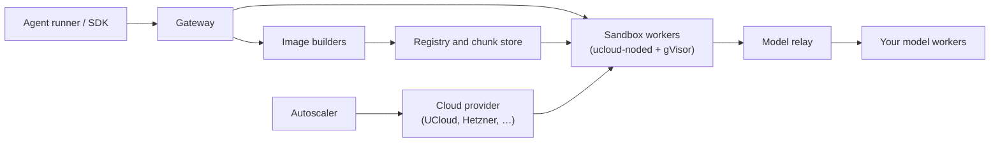

# sandboxes

A self-hosted service for running AI agents and their tools in isolated Linux
sandboxes. Each coding agent, evaluation task or RL rollout gets its own
environment: pick an image and CPU, memory and disk, then run commands and move
files through a Python SDK or HTTP API.

The service runs a shared pool of VMs on any cloud with a provider plugin: **SDU
UCloud** (where production runs) and **Hetzner Cloud** are built in, and another
cloud needs one class implementing the `ComputeProvider` interface
([operations](docs/operations.md#adding-a-provider)). Clients use one gateway URL and an API token;
the service handles placement, routing, image builds and scaling.

> **This repository is the server.** Clients install
> [`verifiers-ucloud`](https://github.com/rlrs/verifiers-ucloud) at a tag
> (`uv add "verifiers-ucloud @ git+https://github.com/rlrs/verifiers-ucloud@v0.3.8"`),
> which pins the [SDK](https://github.com/rlrs/ucloud-sandboxes-sdk) release it was
> tested with. `main` is what production runs; releases are tagged `vX.Y.Z` and
> listed in the [changelog](CHANGELOG.md).

## What it does

- **Isolated sandboxes.** gVisor sandboxes with a persistent workspace; run and
  stream commands, transfer files.
- **Images on demand.** Use an OCI image, a prepared task image from the image
  index, or a recipe built by the service. Workers mount images read-only and
  fetch only what a sandbox reads.
- **Agents that wait cheaply on models.** A managed agent's sandbox stays in memory
  while its model call runs, and is paused or checkpointed to disk under memory
  pressure, so many more agents fit on a worker. An OpenAI-compatible relay
  connects sandboxes to your model workers and coordinates the waits.
- **A shared, autoscaled pool.** Per-sandbox resources, capacity prepared ahead of
  a burst, and sandbox and builder pools that grow and shrink with demand.



## Use a sandbox

You need a running deployment and its sandbox API token:

```bash
export UCLOUD_SANDBOX_URL="https://sandbox-gateway.example.org"
export UCLOUD_SANDBOX_API_TOKEN="<your sandbox API token>"
```

```python
from uuid import uuid4

from ucloud_sandboxes_sdk import Image, SandboxClient, SandboxSpec

client = SandboxClient.from_env()
sandbox = client.create_sandbox(
    SandboxSpec(
        id=f"example-{uuid4().hex}",
        image=Image.from_registry("python:3.12-slim"),
        command=["sleep", "300"],
        cpus=1,
        memory_mb=2048,
        disk_mb=10240,
        ttl_seconds=600,
    )
)
try:
    result = sandbox.exec(["python", "-c", "print('hello')"], timeout_seconds=30)
    print(result.stdout)
finally:
    sandbox.delete()
```

The SDK covers files, async clients, image builds, managed agents and Inspect AI.
Other languages can use the [HTTP API](docs/api.md).

Sandboxes run Linux userspace under gVisor, not a full guest kernel: workloads that
need systemd, kernel modules or host devices won't work.

## Documentation

- [Architecture](docs/architecture.md): components, request paths, state rules,
  nodes and memory, model relay, scaling, isolation
- [Images](docs/images.md): image index, recipes, builds, toolkits, storage
- [API](docs/api.md): endpoints and the semantics callers rely on
- [Operations](docs/operations.md): deploying, upgrading, backups, recovery
- [Roadmap](docs/roadmap.md): open work
- [Decisions](docs/decisions.md): why it is built this way

## Development

[AGENTS.md](AGENTS.md) covers the layout, checks and release steps.
`bash scripts/check.sh` runs everything.
