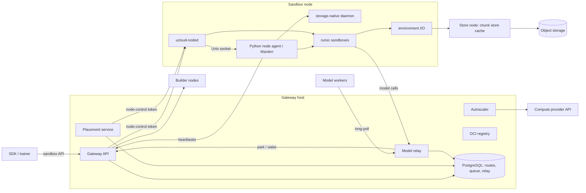

# Architecture

Sandboxes runs untrusted code in gVisor sandboxes on a pool of VMs. One
public gateway owns routing and placement; each sandbox node owns the
processes, storage and local journals of the sandboxes it runs. An autoscaler
buys and releases VMs, and a model relay carries agents' model calls and parks
sandboxes while they wait. This document covers the components, how requests
flow, the correctness rules, and how nodes manage resources. Image formats and
builds are in [images.md](images.md), endpoints in [api.md](api.md), running
the system in [operations.md](operations.md), and the reasoning behind past
choices in [decisions.md](decisions.md). For every config key and default, run
`uv run sandboxes sample-config` or read
[config.py](../sandboxes/config.py).

## Components

**Gateway host** (the control plane):

- `ucloud-sandbox-gateway`: the only client-facing endpoint. It
  authenticates callers, allocates generations, records operation intent,
  forwards traffic to the owning node, and returns retry-aware JSON errors.
  Several API processes (`gateway_processes`) can share one port.
- `ucloud-sandbox-placement`: executes durable wake commands; API processes
  claim and run queued creates and groups.
- `ucloud-sandbox-relay`: the model relay (below).
- `ucloud-sandbox-autoscaler`: the only process allowed to create or stop VMs.
- `ucloud-sandbox-registry`: OCI registry for built images and checkpoints.
- `ucloud-sandbox-builds`: image builds inside sandboxes (off by default).

**Sandbox nodes**, set up at boot by
[vm_init.py](../sandboxes/vm_init.py):

- `ucloud-sandbox-node`, the Python node agent. Its Warden owns every sandbox
  on the node (OCI bundles, cgroups, `runsc` processes, network namespaces,
  lifecycle journals, the node registry) and it sends heartbeats.
- `ucloud-sandbox-noded`, the Rust daemon `ucloud-noded`
  ([runtime/noded](../runtime/noded)), which behind flags takes over the
  port, creates, execs, the pause tier and admission (see
  [below](#the-python-agent-and-ucloud-noded)).
- `ucloud-storage-native`: writable volumes, memory backing, checkpoint
  publication.
- `ucloud-environment-io`: serves immutable image roots from the chunk store.

Docker and containerd only pull OCI images; they never own a sandbox.

**Builder nodes** run BuildKit for Dockerfile builds that cannot run inside a
sandbox; the autoscaler starts them on build demand. **The store node** sits
outside the pool and caches the content-addressed chunk store from object
storage (workers verify every chunk, so it is untrusted), plus a package
cache for builds. See [images.md](images.md).

## Request paths

### Create

1. `POST /v1/sandboxes` carries the sandbox's `cpus`, `memory_mb` and
   `disk_mb`; the gateway validates it and pins the image to an immutable
   reference.
2. The create becomes a durable command in the placement queue. Disconnecting
   does not cancel it, and queued creates count as autoscaler demand.
3. An API process claims the command, picks a node
   ([Placement](#placement)) and, in one routing transaction, allocates the
   next generation, writes the route intent (`creating`, operation ID, spec
   hash, node and boot epoch) and binds the command to that generation, so a
   replay cannot recreate a deleted incarnation.
4. Outside any transaction, the node admits the create, registers it with its
   generation fence and disk claim, prepares storage, rootfs and network, and
   starts `runsc`.
5. The receipt confirms the incarnation. An ambiguous outcome keeps route,
   generation and operation ID for retries on the same node; a definite
   rejection may move on as a fresh generation; if nothing fits, the gateway
   records pending demand and returns a retryable 503.

### Exec and files

`POST /v1/sandboxes/<id>/exec` reads the route and forwards to the owning node;
a parked route is woken first. The gateway signs a session prefix (HMAC over
sandbox, generation and worker), so follow-up polls, stdin, signals and closes
route by heartbeat without touching the database; a session name without a
valid prefix is unknown (404). Heartbeats with node or job IDs over 128 bytes are
refused, so every route fits a prefix. A session is never
redirected to another node: a lost owner gives 410 `exec_worker_lost`. Files,
archives and managed-process jobs follow the same routing and implicit-wake
rules. None of this enters the placement queue.

### Park

A park frees CPU and memory but keeps the generation, rootfs identity,
writable volume and disk claim. Parks come from the control API, the node's
idle timer (`sandbox.direct_idle_park_seconds`, off; never for managed
agents), or the relay's model-wait protocol. The node checkpoints the sandbox
(optionally publishing it so it can move) or pauses it in place. The gateway
commits the parked state only with the routed node's acknowledgement, which
carries its boot epoch and a post-transition activity epoch.

### Wake

A wake is explicit (`operation_id` + `generation`) or implicit from traffic to
a parked route, and goes through the placement queue. It restores on the
owning node when that node has capacity; otherwise a published park migrates
under a gateway journal whose atomic route switch is the ownership commit
point. Retrying continues the same journal and never creates a generation.

### Delete

`DELETE` first records a durable delete operation ID on the route, then sends
a generation-fenced delete. The node keeps a tombstone with the greatest
deleted generation, so a delayed create cannot resurrect it. If the node is
silent, the delete stays recorded (later traffic gets 409
`sandbox_delete_pending`) and the autoscaler replays it.

## State and correctness rules

Each fact has exactly one authority; caches, notifications and heartbeats
speed things up but never own state.

- **Routing store** (PostgreSQL): routes
  with generation high-water marks, owner node and boot epoch, operation IDs
  and snapshot manifests, plus the placement queue, migrations, model-wait
  program state, pending demand and loss records.
- **Relay store** (PostgreSQL): registrations, requests, responses, delivery
  obligations.
- **Gateway-local SQLite:** heartbeats and quarantine labels
  (`control-state.sqlite`); the provider operation journal and drain intents
  (`autoscaler-state.sqlite`, autoscaler only).
- **Each node's registry and journals:** what the node actually runs
  (registrations, tombstones, disk claims, drain row). They work without the
  gateway.
- **Registry and object storage:** image and checkpoint bytes; databases hold
  only verified references.

The queue shares a database with the routes, so an operation and its pending
work commit atomically; LISTEN/NOTIFY is only a hint over polling.

The rules every component follows:

1. **Identity.** An incarnation is `(sandbox_id, generation)`. Generations are
   allocated by the control plane, increase monotonically and are never
   reused, even after deletion. Each create or delete has a stable
   `operation_id` that every retry reuses, plus a `spec_hash`.
2. **Node fencing.** Same generation, operation and spec is an idempotent
   replay; same generation with different operation or spec is a conflict; a
   lower generation is stale and has no effect; a higher generation cannot
   replace a live lower one until it is deleted and fenced; delete never acts
   on a newer live generation.
3. **Intent before effect.** The control plane persists intent before any
   network call, and no RPC runs inside a database transaction. Delivery is at
   least once; stable operation IDs and node journals make it idempotent.
4. **Uncertain is not failed.** A timeout makes an operation uncertain; it
   keeps its generation, node and operation ID until evidence settles it.
   Absence from inventory does not cancel an in-flight request. A new
   generation may be placed elsewhere only after a definite rejection, an
   acknowledged delete, or a recorded loss.
5. **Silence is never loss.** A late heartbeat, failed probe or provider
   suspension makes a node unschedulable and its traffic retryable (503). It
   never deletes a route or stops an occupied VM. Before answering 503 the
   gateway pulls the node's heartbeat directly, so a late push is not mistaken
   for silence.
6. **A new boot loses processes, not disk.** A fresh authenticated heartbeat
   with a new `node_epoch` retires the old boot: running and paused
   incarnations are lost (410 `node_lost`, reason `rebooted`), complete local
   parks are re-adopted, published parks detach and can wake elsewhere.
7. **Owner loss** (a final provider state) deletes routes with a loss row (410
   `node_lost` for 7 days) except published parks, which detach.
8. **Termination needs proof.** A VM is stopped only after a drain handshake
   (a durable token the node acknowledges in a fresh, complete, empty
   heartbeat) or, for VMs that never heartbeated or fail a direct probe, an
   unreachable-and-empty proof. No provider status alone authorizes a stop.
9. **Provider mutations are journaled.** Every VM create or stop is recorded
   before the call and labelled with its operation ID; an uncertain result is
   settled from a full provider inventory, never blindly resubmitted.

## Node resources

### Resource model

A sandbox's `cpus`, `memory_mb` and `disk_mb` are maximums, enforced inside the
sandbox, not reservations. They must fit the node's shape.

- **CPU** is a cgroup quota and is not part of admission: a sampled spike
  should not bounce queued work to another node.
- **Memory** is a cgroup limit. Admission charges live evidence plus forecasts
  of in-flight transitions; resident sandboxes reserve nothing.
- **Disk** is a hard, additive claim in the node registry and is never
  overcommitted. Parked sandboxes keep their claim.

A memory shortfall waits within a deadline (30 s by default); a disk
shortfall is refused at once with a retryable error.

### Admission

Each node admits its own work; the gateway only chooses a node. Three FIFO
pools bound concurrent transitions: startup (`create_target_concurrency_per_node`,
default 8), restore (`sandbox.direct_max_concurrent_restores`, default 8) and
publication. Inside a slot, the decision samples the host and waits while any
of these hold:

- memory PSI `full avg10` is at least 10;
- `MemAvailable` is below a 2 GiB physical floor;
- available memory plus free swap is below `max(2 GiB, requested memory)`;
- the transition ledger's projected demand (and RAM-backing demand) does not
  fit the headroom.

The **transition ledger** charges each in-flight operation its forecast
(creates their memory bound, restores the checkpoint size, captures nothing),
so concurrent admissions cannot spend the same headroom, and queued restores
go before new startups. Missing evidence never reads as plenty. A refusal
before dispatch is a safe retry (503); a failure after the runtime started
stays ambiguous.

**Managed growth forecasts.** A managed agent starts, allocates a large heap,
then mostly waits for the model, so the node forecasts per agent: the launch
carries the whole memory bound, a model wait suspends the charge, and a
continuation reacquires its demonstrated peak minus current footprint before
the wake is acknowledged. (Charging the full bound on every continuation
stalled answers on busy nodes.)

### Tiers: resident, paused, parked

An idle sandbox sits in one of these tiers; each step down frees more memory
and costs more to come back from.

| Tier | Memory lives in | Gateway sees | Resume cost |
| --- | --- | --- | --- |
| Resident | RAM | running | none |
| Paused | RAM, partly swapped under pressure | running | thaw: milliseconds plus swap-in |
| Parked | checkpoint on local disk | parked | restore, via restore admission |
| Parked and published | checkpoint also in object storage | parked | restore, possibly on another node |

- **Resident waits (default).** For a relay model wait the node stays
  running and answers `409 park_deferred` while memory headroom exists; under
  pressure it checkpoints the waits likely to stay idle longest. There is no
  model-wait timeout and no fixed sandbox cap.
- **Pause tier** (`sandbox.direct_pause_tier`, off; needs swap) pauses waits
  in place with `runsc pause`, reclaims their memory to swap under pressure,
  and escalates a stalled reclaim to a hibernate. Pausing changes no
  ownership; any exec, file operation or wake thaws.
- **Park** reserves checkpoint disk (or refuses with `park_deferred`),
  captures memory, Sentry state and filesystem writes, seals the workspace
  into an immutable layer, and commits a single COMPLETE pointer. A failure
  before COMPLETE resumes the original; the old checkpoint stays
  authoritative until a restored runtime is durably running.

### Memory and disk

Memory backing flags (all off by default) move a sandbox's memory file out of
its storage volume into an XFS project-quota directory
(`direct_split_memory_backing`) or a bounded tmpfs
(`direct_ram_memory_backing`). With split backing, disk claims follow
demonstrated use: a workspace filesystem starts at 512 MiB and grows online
toward `disk_mb`, and a running RAM-backed sandbox's checkpoint claim is
64 MiB until a park reserves a strict upper bound of its capture (running out
of space mid-capture could lose it). RAM rather than disk then limits density.
Under disk pressure the node publishes parked sandboxes and the gateway
cold-offloads old published parks; after that, work is refused.

### The Python agent and ucloud-noded

The node side began as one Python process, and under create bursts the
interpreter lock was the bound (doubling create slots changed nothing).
`ucloud-noded` takes over the node in slices, each behind the same HTTP
contract and on-disk files, so each slice rolls back by turning its flag off.
Each flag requires the ones above it; all default off.

| `sandbox.` flag | What moves to noded |
| --- | --- |
| `direct_node_front_door` | The node's TCP port; it proxies to the agent's Unix socket. |
| `direct_node_rust_create` | Node registry ownership and the create pipeline; managed-job status and log reads. Unsupported creates (relay egress, DNS-named egress, migration imports) go to the agent unchanged. |
| `direct_node_rust_exec` | Execs on running, unpaused sandboxes; managed-job start and signal. |
| `direct_node_rust_pause` | The pause tier, thaw-on-exec, reclaim and node-local model waits. |
| `direct_node_rust_admission` | The transition ledger, slots, growth forecasts and resident sampling. |

Always in the Python agent: heartbeats; park, wake, migration and delete
with their lifecycle locks; the drain row; workspace growth. The processes
coordinate through the kernel and files, not a lock manager: per-sandbox
flocks fence execs against parks, and admission claims are tokens bound to
the agent's session, so a restart of either side cannot leak or double a
grant. Managed-job state sits in a host-visible bind mount, so noded serves
job status and logs without entering, thawing or locking the guest.

## Managed agents and the model relay

An agent runs as a managed process (SDK `start_agent()`), not an attached
exec: a managed process keeps its status and logs across park, wake and
cross-node restore, while a sandbox with an attached exec refuses to park.

The relay is an OpenAI-compatible endpoint that queues each call durably in
PostgreSQL. Model workers long-poll it for work, run inference, and post
answers back; neither side needs an inbound port. Every endpoint checks a
credential (worker token, sandbox token, or a per-registration capability URL),
because network reachability grants nothing.

**Leases and idempotency.** A poll leases a request; an expired lease
requeues it and a stale lease cannot commit, so execution is at least once and
the response POST is the commit point. A disconnected caller's retry
reattaches to the original request instead of running inference twice.

**Durable acceptance.** `/worker/respond` commits the answer and its wake
obligation in one transaction and returns at once. The receipt proves the
answer is durable, not that the sandbox is awake; a slow wake never turns an
accepted answer into an error.

**The model-wait cycle.** For a rollout bound to a managed sandbox generation:

1. Call accepted: the relay records a park obligation and asks the gateway to
   park, fenced by request and generation. The gateway marks the program state
   `model_wait`.
2. The node decides what that means: usually it stays resident (409
   `park_deferred`, the relay keeps retrying); under pressure it pauses or
   checkpoints. A checkpoint drops the agent's connection; its retry
   reattaches after restore.
3. Answer committed: the relay records and dispatches a wake. A resident
   sandbox ignores it; a parked one restores locally or migrates. A durable
   wake fence stops a delayed park acknowledgement from undoing the wake.

Obligations are PostgreSQL rows claimed by relay dispatchers, never held in
a transaction across a gateway call, so no crash loses an accepted answer or
strands a parked sandbox.

**Node-local model waits** (`sandbox.direct_local_model_waits`, off; needs
the pause tier) skip the relay and gateway in the common case: the node reads
only TCP headers of plaintext relay flows on the private network, pauses an
idle sandbox whose request has gone out, and thaws it on the answer's first
packet (about 10 ms). A durable backup wake fires after 5 s unless the guest
acknowledged the answer. (TLS would not work: session tickets look like a
reply.)

## Scaling and placement

### Pools and the autoscaler

The autoscaler plans a **sandbox pool** and a **builder pool** independently
through a small provider interface ([providers/](../sandboxes/providers);
UCloud in production, Hetzner maintained). Each 5 s cycle it subtracts what
ready and booting nodes can take from demand and creates VMs for the deficit,
within `min_nodes`/`max_nodes` and provisioning caps. Demand comes from:

- **Pending demand:** creates and wakes that could not be placed (expires
  300 s after the last attempt, so abandoned clients release VMs).
- **Prepared capacity:** `POST /v1/capacity/prepare` announces a batch before
  its first create so VMs boot early; each matching create claims one unit.
- **Pressure feedback:** sustained live pressure (CPU, memory, PSI, storage
  queues) and startup backlog may add up to one node of headroom.

Cold demand is sized from history, not limits: memory is charged
`min(request, 1.25 × peak)` from past runs of the same image and shape, disk
the initial workspace grant plus the idle memory claim. A low forecast only
delays scale-up; node admission still owns safety.

**Scale-down** always goes through the drain handshake (rule 8) after
`scale_down_idle_seconds` (extended by recent pressure and boot latency). A
busy RL fleet is never idle, so **drain on park** (default on) soft-drains one
surplus worker at a time by migrating its parks elsewhere; workers that
rebooted twice in 24 h are retired the same way. A suspended UCloud job is
quarantined from placement but keeps its routes until continuity is proven.

### Placement

Power-of-k: each API process samples three eligible nodes from its heartbeat
view, scores them by load (live pressure plus in-flight creates, its own
counted at once) minus image residency, and lets the node's admission decide;
soft-drained nodes are a last resort. Earlier candidates get a one-second
admission wait. A definite rejection retargets the intent, as a fresh
generation, to the next candidate that still fits once this process's newer
in-flight creates are counted. When every candidate rejects, the demand is
queued and the client gets a retryable 503. Group creates
(`POST /v1/sandboxes:batch`) also consider every node whose heartbeat holds
the image, scored as resident, and pack: they fill the best node up to a
per-node budget before the next.

Wakes stay on their own node when it fits; otherwise the gateway migrates a
published snapshot to a fitting node. Checkpoint import requires an identical
runtime fingerprint, including CPU feature flags.

## Isolation and workload compatibility

**Trust model.** Every sandbox workload is hostile. It must not reach the
host, other sandboxes, node-control or storage services, or private
infrastructure. Trusted: the gateway host, each worker host with its Warden,
firewall and pinned runtime, and the private network between them. Out of
scope: mutually untrusted node operators (the node-control token is
deployment-wide) and secrets injected into a sandbox (the workload can see
them).

**Runtime boundary.** gVisor's userspace kernel sits between the workload and
the host kernel. Each node runs the deployment-pinned, patched `runsc`, and
boots only from a digest-verified package bundle. Node-control and storage
sockets are never mounted into a workload. Snapshots restore only into a
runtime with the same compatibility fingerprint.

**Credentials.** Four independent tokens, which must differ: the **sandbox
API key** (SDK clients: sandbox, exec, file, image, build and
prepared-capacity routes only), the **gateway control token** (operators,
autoscaler, relay: everything, including explicit park, wake and migration),
the **heartbeat token**, and the **node-control token** for gateway-to-node
calls. The gateway strips client credentials before forwarding; only its port
is public. The relay has its own tokens and per-registration capability URLs.

**Network modes.** A sandbox asks for `network: "bridge"` (default) or
`"none"`. Bridge sandboxes get their own namespace, veth pair and NAT (IPv4,
public DNS); the host drops their traffic to itself and to every private
range, so they cannot reach workers, the gateway or cloud metadata. Exact
private TCP exceptions go in `sandbox.direct_network_allow_tcp`. A
`relay_only(<name>)` network policy restricts a sandbox to one relay from
`sandbox.network_relays`, enforced in nftables; relays named by DNS appear in
the sandbox at a stable virtual address via `/etc/hosts`, so sandboxes never
resolve private names. Placement requires the node to advertise the relay, so
a restricted sandbox never runs unrestricted.

**Workload profiles.** `container` (default) runs the image entrypoint as
UID/GID 1000 with no capabilities, `no_new_privileges` and 256 PIDs;
`linux_session` adds a persistent shell session with the same restrictions;
`linux_host` is a root-capable benchmark session with no inner PID limit.
Users resolve only against the image's own `/etc/passwd` and `/etc/group`.

**What does not work.** gVisor is not a VM. Workloads that need host kernel
modules, nested container runtimes, privileged mounts, cgroups, systemd or
reboot, unsupported syscalls or devices, or exact `/proc` behaviour are
outside the contract, and the system does not fall back to a weaker backend.
Streaming model responses through the relay is not supported. A sandbox with
`network: "none"` or relay-only egress cannot download packages, so install
dependencies in the image. Not every task in the Prime 23-family inventory
passes; unknown or unqualified `required_features` fail at create rather than
silently weakening isolation.
