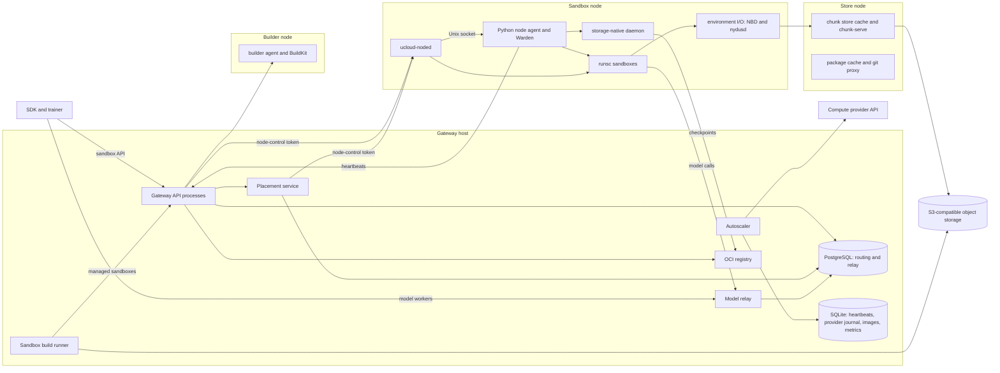

# Architecture

UCloud Sandboxes runs untrusted code in gVisor sandboxes on a pool of VMs. A
single public gateway owns routing and placement; each sandbox node owns the
processes, storage and local journals of the sandboxes it runs. This document
describes the components, where each piece of state lives, and the path a
create, exec, park and wake request takes. The crash-safety rules that every
component follows are specified in [state-protocol.md](state-protocol.md).

## Components

### Gateway host

The gateway host runs the control plane. Every service reads the same
deployment configuration.

| Service | Role |
| --- | --- |
| `ucloud-sandbox-gateway` | The only client-facing endpoint. Authenticates callers, allocates generations, records operation intent, forwards sandbox traffic to the owning node, and translates transport failures into structured errors. `gateway_processes` (default 1, at most 16) API processes share one port. |
| `ucloud-sandbox-placement` | Executes durable create and wake commands from the PostgreSQL queue on a loopback listener at gateway port + 1. Its `ExecCondition` keeps it stopped on SQLite installations. |
| `ucloud-sandbox-relay` | The [model relay](model-relay.md): agents' model calls, the trainer's responses, and the model-wait park/wake protocol. |
| `ucloud-sandbox-autoscaler` | Reconciles pending demand against provider instances and heartbeats, creates and drains VMs, and replays recorded deletes. Only one process per deployment may mutate the provider (see [scaling-policy.md](scaling-policy.md)). |
| `ucloud-sandbox-registry` | The private OCI registry: built and imported images, and storage-native checkpoints when they publish to the registry. Pruning, GC and disk-pressure timers keep it bounded. |
| `ucloud-sandbox-builds` | Runs sandbox builds (below) when `immutable_environments.sandbox_builds.enabled` is set; off by default. It holds the chunk store's S3 key; the API processes never do. |
| `ucloud-sandbox-chunk-index` | The chunk store's global index, used by image conversion and GC, when the index is not served from the store node. |

### Sandbox nodes

A sandbox node is a VM that runs sandboxes and nothing else that clients can
reach. Its services are written by [vm-init](../ucloud_sandboxes/vm_init.py):

- **`ucloud-sandbox-node`** runs the Python direct node agent
  (`serve-direct-node-agent`). It contains the direct Warden, which owns every
  sandbox task on the node: OCI bundles, cgroups, `runsc` processes, network
  namespaces, lifecycle journals and the node registry
  (`direct-registry.sqlite`). It builds and sends heartbeats.
- **`ucloud-sandbox-noded`** is `ucloud-noded`, a Rust daemon
  ([runtime/noded](../runtime/noded)). When enabled it owns the node's TCP port
  and forwards to the agent on a Unix socket; further flags move whole
  subsystems into it. The split is described in
  [The node agent and ucloud-noded](#the-node-agent-and-ucloud-noded).
- **`ucloud-storage-native`** and its backend own each sandbox's writable
  volume, memory backing and checkpoint publication.
- **`ucloud-environment-io`** serves immutable image roots to sandboxes: it
  mounts RAFS bootstraps with kernel EROFS over an NBD backend and reads chunks
  from the chunk store.

Docker and containerd remain image infrastructure on the node (pulling OCI
images that are not yet chunk-store roots). They never own a sandbox process
or writable volume.

Each node registry binds one runtime-compatibility digest derived from the
`runsc` binary, its commit and its boot configuration. Checkpoints and
migrations additionally carry the exact sandbox runtime fingerprint, including
its image-specific rootfs, so a snapshot is restored only by a compatible
runtime.

### Builder nodes

Builder nodes run `serve-builder-agent` with BuildKit. They build Dockerfile
images that cannot run as sandbox builds, push them to the registry, and
advertise the `image-build` capability. They never run sandboxes and do not use
sandbox admission. The autoscaler creates them on build demand and stops them
when idle. See [images.md](images.md).

### Store node

The store node is a VM outside the sandbox pool; it has no node agent and sends
no heartbeats, so placement never sees it. It runs:

- **`ucloud-chunk-store`** ([chunk_store_node.py](../ucloud_sandboxes/chunk_store_node.py)):
  a read-through cache (or, with `replica`, a full mirror) of the chunk store's
  packs, bootstraps and chunk maps in S3. Workers read through it with the
  index's read token and never hold S3 credentials. It is untrusted: workers
  verify every chunk.
- **`ucloud-chunk-serve`** ([runtime/chunk_serve](../runtime/chunk_serve)), an
  optional Go server pinned by `store_node.native_server_sha256`. It answers
  reads of resident extents on every core and forwards misses, bad tokens and
  control requests to `ucloud-chunk-store`, which stays the one authority on
  fills and errors.
- Optionally `ucloud-chunk-index` (`serve_index`) and `ucloud-package-cache`,
  an allowlisted caching proxy for package mirrors that builds use, which can
  also serve authenticated GitHub fetches.

The chunk store itself is content-addressed: images are converted to Nydus RAFS
v6, each chunk of at most 256 KiB is stored once in an immutable pack, keyed by
the sha256 of its uncompressed bytes, and each image root is signed. Formats,
GC and trust are in [images.md](images.md).

### Image builds on sandbox nodes

A recipe image that is a prepared foundation plus a few task steps is built
inside an ordinary managed sandbox on a sandbox node, not on a builder. The
gateway decides per recipe (`gateway/sandbox_builds.py`); the runner on the
gateway host creates the sandbox through the gateway API from the base's
chunk-store root, runs the steps as one managed job, exports the sandbox's
writable layer, converts only that layer and stacks it on the base's bootstrap.
No OCI image is read or written. Build sandboxes are placed, admitted and
scaled like any other sandbox. Recipes the planner cannot run go to builders.
See [images.md](images.md).

## Where state lives

Each fact has exactly one authority. Caches, notifications and heartbeats can
speed things up but never own state.

| State | Authority |
| --- | --- |
| Sandbox routes: generation high-water marks, owner node and boot epoch, create and delete operation IDs, worker state (attached, detaching, detached), snapshot manifest | Routing store: PostgreSQL in production, SQLite for standalone deployments. Selected by the descriptor at the routing-file path (`routes.sqlite`). |
| Queued create and wake commands, migrations, exec routes, program (model-wait) state, pending demand, loss records | Same routing store, same transactions. |
| Relay registrations, requests, responses and delivery state | Relay store: PostgreSQL or SQLite (`relay_postgres`). It never becomes a second sandbox owner. |
| Node heartbeats, boot-epoch retirements, quarantine labels | `control-state.sqlite` on the gateway host. |
| Provider operation journal, drain intents, pending-delete attempts | `autoscaler-state.sqlite`, written only under the autoscaler lock. |
| Image catalog | `images.sqlite`. |
| Node-local ownership: registrations, generation tombstones, disk claims, drain row, lifecycle journals | Each node's registry and journals. They work without the gateway or database. |
| Image and checkpoint bytes | Registry and S3-compatible object storage. Databases hold only verified references. |
| Live HTTP sockets and exec streams | Process-local. A lost socket is lost; a persisted row does not preserve it. |

## Component boundaries

Each boundary below owns a set of decisions and must not take over another's.
Separate journals exist where they match a real authority or privilege
boundary; one canonical way does not mean one database for everything.

| Boundary | Owns | Must not own |
| --- | --- | --- |
| Model relay and its store ([model_relay.py](../ucloud_sandboxes/model_relay.py), [shared_control/relay.py](../ucloud_sandboxes/shared_control/relay.py)) | Registrations, inference leases, committed responses, delivery obligations, retry schedule | Sandbox runtime or owner assignment |
| Gateway lifecycle and routing store ([control_plane.py](../ucloud_sandboxes/control_plane.py), [routing.py](../ucloud_sandboxes/routing.py)) | Incarnation and owner, generation allocation, operation intent, placement queue, migration journal, route transitions | Process or device operations on nodes; a second copy of relay responses |
| Autoscaler and provider adapters ([providers/](../ucloud_sandboxes/providers)) | VM create, observe and stop; the provider operation journal; drain intents; termination proofs | Relay, rootfs or per-sandbox scheduling special cases |
| Node registry ([direct_registry.py](../ucloud_sandboxes/direct_registry.py); noded's `registry/` with Rust creates) | Local registrations, generation and migration tombstones, exact disk claims, the drain row | Fleet scheduling decisions |
| Warden and lifecycle journal ([direct_warden.py](../ucloud_sandboxes/direct_warden.py), [hibernation.py](../ucloud_sandboxes/hibernation.py); noded for creates, execs and the pause tier when their flags are on) | Safe points; quiesce, capture, thaw and restore; exact execution authority over `runsc` | Provider VM policy or an independently interpreted copy of scheduling state |
| Node admission ([transition_admission.py](../ucloud_sandboxes/transition_admission.py), [resource_admission.py](../ucloud_sandboxes/resource_admission.py); noded's `admission/` with Rust admission) | Typed transition costs, fair slot queues, managed growth forecasts, live-pressure limits | A second quota ledger or provider-specific policy |
| Workspace store: the storage-native daemon ([storage_native_daemon.py](../ucloud_sandboxes/storage_native_daemon.py)) | Writable allocations, mounted leases, immutable revisions, publication and release | Memory placement or execution authority |
| Memory backing store ([memory_backing.py](../ucloud_sandboxes/memory_backing.py)) | Quota-owned local memory files, capture and restore leases, durable component data | Another sandbox lifecycle state machine |
| Checkpoint manifest ([checkpoint_components.py](../ucloud_sandboxes/checkpoint_components.py)) | One immutable binding of component generations, the managed ledger, and runtime and environment identity | Mutable progress or a second commit point |
| Environment manifest and rootfs manager ([environment_manifest.py](../ucloud_sandboxes/environment_manifest.py), [environment_rootfs.py](../ucloud_sandboxes/environment_rootfs.py)) | Ordered immutable image components, composition, the rootfs lease and fingerprint | Checkpoint ownership or memory policy |

PostgreSQL is the shared authority for routing and the relay in production.
Node-local registries and journals remain the recovery authority for what a
node actually runs. Running several gateway API processes shares the routing
authority; it does not add a second one.

## Trust boundaries

Four distinct credentials separate the trust channels: the sandbox API key for
SDK callers, the gateway control token for operators and internal controllers,
the heartbeat token for node heartbeats, and the node-control token for
gateway and autoscaler calls to nodes. The gateway refuses to start if any two
are equal. The SDK key reaches only sandbox, exec, file, image, build and
prepared-capacity routes; explicit park, wake, detach and migration, node
inventory and registry state require the control token. Every node endpoint
except `/healthz` requires the node-control token, and the gateway strips client
authorization before attaching it. The gateway and all VMs share one private
network; only the gateway port is public, and node URLs are never shown to
clients. Details are in [security.md](security.md).

## Request paths

### Create

1. The client sends `POST /v1/sandboxes` with its own `cpus`, `memory_mb` and
   `disk_mb`. The gateway validates the spec and resolves its image to an
   immutable reference.
2. With the PostgreSQL authority, the create becomes a durable command in the
   placement queue. The API process transfers the waiting socket to
   asynchronous I/O and waits for the result; disconnecting does not cancel the
   accepted command, and queued creates count as demand for the autoscaler.
3. The placement service claims the command under a renewable lease. In one
   routing transaction it allocates the next generation from the high-water
   mark, writes the route intent (state `creating`, create operation ID, spec
   hash, target node and boot epoch) and binds the command to that generation,
   so a replay can never recreate an explicitly deleted incarnation.
4. The node is chosen by `gateway_create_placement`:
   - `ranked` (default) ranks ready nodes advertising `sandbox` by live
     pressure and reserves capacity in a worker-revision-fenced transaction;
   - `power_of_k` samples a few capable nodes, writes the intent without a
     fleet capacity read, and lets the node's admission decide. A definite
     rejection moves the intent to the next candidate as a fresh generation.
5. The worker RPC runs outside any database transaction. On the node, noded
   either runs the create itself (Rust creates enabled and the spec fully
   supported) or forwards it unchanged to the agent. The node admits the
   create (startup slot and memory), registers it in the node registry with its
   generation fence and exact disk claim, prepares storage and the rootfs,
   creates the network, and starts `runsc`.
6. The worker's receipt confirms the exact incarnation. An ambiguous outcome
   keeps the route, generation and operation ID; retries reuse them on the same
   node until inventory settles it. If no node fits, the gateway records
   pending demand and the autoscaler adds capacity.

### Exec and files

`POST /v1/sandboxes/<id>/exec` reads the route and forwards to the owning node.
If the route is parked, the request first performs the same fenced wake as an
explicit wake. The gateway sends `X-UCloud-Exec-Session-Prefix`, an HMAC-signed
binding of sandbox, generation and worker job; the node names the session
`<prefix>.<random>`. Follow-up polls, stdin, signals and closes verify the
prefix and route by the worker's heartbeat, without reading the routing
database. The route table is read only when that worker is stale or absent, to
tell a lost owner (410 `exec_worker_lost`) from a deleted incarnation (404) and
a silent worker (503). A session is never redirected to another node. A worker
that ignores the header gets an indexed exec-route row instead.

On the node, noded runs the exec itself when Rust execs are enabled and the
sandbox is owned, running, unpaused, not draining and not being transitioned;
the fences are kernel flocks shared with the agent. Anything else goes to the
agent. File transfer (`/files`, `/archive`) and managed-process jobs (`/jobs`)
follow the same routing and implicit-wake rules. Exec, uploads and inference
never enter the placement queue. Endpoint details are in
[api-reference.md](api-reference.md).

### Park

A park releases a sandbox's CPU and memory while keeping its generation, its
rootfs identity, its writable volume and its exact disk claim. Parks come from:

- `POST /v1/sandboxes/<id>/park` with the control token;
- the node's idle timer (`sandbox.direct_idle_park_seconds`, default 0, off),
  which never parks `managed_process` sandboxes because request inactivity
  cannot prove a long-lived agent is at a safe point;
- the relay's model-wait protocol for managed agents, which coordinates the
  client, the gateway's program state and the relay request (see
  [model-relay.md](model-relay.md)).

The node parks through one lifecycle coordinator under the sandbox's lifecycle
lock. A park either checkpoints the sandbox into a storage-native manifest,
optionally publishing it so it can migrate, or, with the pause tier
(`sandbox.direct_pause_tier`, off by default), freezes it in place and lets its
memory swap. The acknowledgement carries the node's boot epoch and a
post-transition activity epoch, and the gateway commits the new state with that
proof.

### Wake

A wake is explicit (`POST /v1/sandboxes/<id>/wake` with `operation_id` and
`generation`) or implicit, from tool traffic to a parked route.

1. If the owner is already running or waking, the gateway forwards the
   generation-fenced wake straight to it. The gateway rereads the route before
   forwarding and falls back to the queue if it parked in between.
2. Otherwise the wake enters the placement queue. Known-owner local wakes are
   batched per node and take a per-worker turn before their transaction.
3. A local wake restores on the owning node when its admission has capacity.
4. Otherwise, a parked route whose verified `storage-native-v1` manifest is
   published, between nodes that both advertise
   `sandbox-migrate-storage-native-v1`, migrates. The gateway journals
   destination reservation, source publication, destination import, the atomic
   route switch, activation and source finalization. The route switch is the
   ownership commit point; retrying continues the same journal and never
   creates another generation.

With node-local model waits (`sandbox.direct_local_model_waits`, off by
default), a node pauses a sandbox on its outstanding model call and thaws it on
the answer, so the relay sends no park and wakes only unacknowledged answers.

### Delete

`DELETE /v1/sandboxes/<id>` first records a durable delete operation ID on the
route, then sends a generation-fenced delete to the node. The node writes a
tombstone with the greatest deleted generation, so a delayed create cannot
resurrect it. If the node is silent, the delete stays recorded, later traffic
gets 409 `sandbox_delete_pending`, and the autoscaler replays it.

## Placement and the routing authority

PostgreSQL holds the routing domain and the durable lifecycle queue.
[`shared_control/routing_repository.py`](../ucloud_sandboxes/shared_control/routing_repository.py)
implements the same `RoutingStore` domain operations as the SQLite backend, so
fences, migrations, program state, exec routes, demand and snapshot liveness
move together; there is no second ownership model and no dual write.

- **Queue.** [`placement_queue.py`](../ucloud_sandboxes/shared_control/placement_queue.py)
  stores commands in `gateway_commands`, claimed with `FOR UPDATE SKIP LOCKED`
  and a claim token. LISTEN/NOTIFY wakes readers after commit; polling stays
  authoritative, so a lost notification costs one interval, never a command.
  Queue I/O runs on its own event loop, and one batched completion reader has
  its own connection so enqueue bursts cannot strand replies.
- **Transactions.** Worker RPCs never run inside a transaction. Database-only
  operations may retry a proven rollback; network calls and ambiguous commits
  are never replayed by that wrapper. Placement uses a repeatable-read snapshot
  plus a durable revision row per worker: every capacity-changing mutation
  (route, inventory, wake batch, program membership, deletion, migration on
  both ends) advances it, so concurrent admissions on one worker conflict
  exactly while unrelated sandboxes do not. Other domain mutations stay
  SERIALIZABLE. Observations that change only freshness or program progress do
  not touch the revision.
- **Turns.** Known-owner create and local-wake batches take a per-worker
  PostgreSQL advisory turn, acquired after a local per-worker turn and before
  borrowing a pooled connection, so waiters for a busy worker do not starve
  others. The turn only suppresses wasted retries; the revision check is the
  correctness mechanism.
- **Reads.** `GET /v1/sandboxes` is served from the route index;
  `?refresh=true` fans out to nodes and reconciles their inventories.

Standalone deployments use SQLite with coherent read-only snapshots for
multi-query readers. Cutover from SQLite to PostgreSQL is a one-way operation
described in [deployment.md](deployment.md).

## The node agent and ucloud-noded

The node side began as one Python process. Under bursts of creates the agent's
interpreter lock was the bound: each create reacquired it hundreds of times,
and doubling create slots from 32 to 64 changed nothing. `ucloud-noded` takes
over the node in slices, each behind the same HTTP contract and the same
on-disk files, so each slice rolls back by turning off its flag. All flags are
under `sandbox` and default to off.

| Flag | Requires | What noded owns |
| --- | --- | --- |
| `direct_node_front_door` | none | The node's TCP port. It forwards every request to the agent's Unix socket, streaming both bodies, and answers 503 `node_agent_unavailable` when the agent is down. |
| `direct_node_rust_create` | front door | The node registry's owner flock, in-memory index and group commit; the create pipeline (registry phases, storage prepare, overlay rootfs, netlink veths and its own prepared-pair pool, `runsc create` and `start`); managed-process job status and log reads. Creates it does not fully support (relay egress, DNS-named egress, unported image kinds, migration imports) are forwarded to the agent byte for byte. |
| `direct_node_rust_exec` | front door, Rust creates | Execs on running, unpaused sandboxes, and managed-process job start and signal. |
| `direct_node_rust_pause` | `direct_pause_tier`, Rust execs | The pause tier: pause and thaw, thaw-on-exec, idle pauses, paused reclaim, escalation decisions and node-local model waits. |
| `direct_node_rust_admission` | all of the above | Node admission: the transition ledger, startup, restore and publication slots, managed growth forecasts and resident sampling, the drain gate's in-process state. The agent reaches it on a private Unix socket (`noded.sock`, mode 0600, peer-uid checked). |

What stays in the Python agent regardless of flags:

- heartbeat assembly and sending (it composes noded's admission snapshot when
  Rust admission is on);
- park, wake, migration, commit and delete execution, and the per-sandbox
  lifecycle locks;
- restore cost quoting, which needs authenticated checkpoint metadata;
- writing the drain row;
- the storage-native daemon and the environment I/O service, which are separate
  processes.

The two processes coordinate through kernel and file mechanisms rather than a
shared lock manager:

- **Registry.** With Rust creates, noded is the registry owner and the agent is
  a foreign SQLite writer on the same file, reading a cached index revalidated
  by activity revision. Rows noded writes re-encode byte-identically under
  Python's codec; cross-language tests pin this.
- **Configuration.** noded does not parse the node's flags. It asks the agent
  for the effective create configuration (`GET /internal/v1/creates/config`,
  with a digest every admission echoes) and forwards creates until it has it; a
  changed digest sends creates back to the agent.
- **Exec fences.** Per-sandbox transition and activity flock files under the
  runtime root, always taken in that order. An exec holds the activity lock
  shared until its session is reaped; park, pause and escalation take the
  transition lock exclusively, then try the activity lock. The activity file's
  mtime is the shared activity clock for idle decisions.
- **Admission.** Without Rust admission, a noded create asks the agent to
  admit it (`/internal/v1/creates/admit`) and to finish it, so the agent's
  ledger stays the single admission owner. With it, noded owns the ledger and
  the agent requests startup, restore, publication and growth grants over
  `noded.sock`. Claims are tokens bound to the agent's session; a restarted
  noded refuses grants with a retryable 503 until the agent reasserts its
  claims or a 2-second grace passes, and a restarted agent's hello releases
  everything held by its previous session. Admission rules are in
  [node-admission-and-memory.md](node-admission-and-memory.md).

## Resource placement

Each sandbox asks for its own `cpus`, `memory_mb` and `disk_mb`. CPU and memory
are per-sandbox cgroup limits: they must fit the node's shape, but they are
caps, not permanent additive reservations. One live-pressure admission
function on the node (available memory, swap, memory PSI and a physical floor)
admits both creates and wakes. Disk is exact and additive: every planned, live
or parked sandbox holds its hard disk claim, and parked sandboxes release only
CPU and memory. Heartbeats report capacity, pressure and storage queueing; the
gateway ranks with them and the autoscaler sizes the pool from them. Details
are in [node-admission-and-memory.md](node-admission-and-memory.md) and
[scaling-policy.md](scaling-policy.md).

## Provider boundary

Provider VMs are pool nodes. Native instance state (UCloud jobs, Hetzner
servers) is normalized at a small adapter boundary
([providers/](../ucloud_sandboxes/providers)) before it reaches policy or
reconciliation, and every provider mutation is reported as accepted, rejected
or uncertain. Mutating operations run only from the autoscaler with
`--execute`. Nodes get stable private DNS names, and heartbeats advertise
node URLs by name. VM bootstrap is [vm_init.py](../ucloud_sandboxes/vm_init.py);
provider setup is in [deployment.md](deployment.md).

## Failure contract

Gateway errors are JSON and say whether a retry is safe. DNS absence,
connection failure, timeout, admission closure and a non-JSON upstream answer
have distinct codes. A failure before a create reaches a node releases the
provisional route; an ambiguous failure keeps the generation and operation ID
until node inventory proves the outcome. A silent node is never treated as
lost: its traffic gets retryable 503s, a confirmed loss gets 410 `node_lost`,
and only a drain acknowledgement or an empty-and-unreachable proof lets the
autoscaler stop a VM. The full rules are in
[state-protocol.md](state-protocol.md).

The gateway bounds request bodies, exec output, session count, file size and
concurrency. Nodes keep their own bounds as well: the node-control token
protects authorization, not resource exhaustion by an authorized caller.

## Design choices

- **PostgreSQL as the shared authority and queue, no Redis.** Placement used
  to serialize on a gateway-wide process lock and file lock; one measured wake
  waited 32 s for the lock and held it 8.8 s with almost no CPU. PostgreSQL
  gives row-scoped transactions and a durable queue in the same database as the
  state it changes, so an operation and its pending work commit atomically. A
  second durable queue or Redis as authority would add a delivery and recovery
  boundary, and Redis's usual persistence and failover settings are not an
  equivalent durability contract for generations.
- **SQLite stays on nodes.** The node registry gives atomic local recovery with
  no network dependency. It is not a replica of the central database and never
  answers fleet scheduling queries.
- **No RPC inside a transaction; at-least-once delivery.** Work is claimed,
  committed, executed and then acknowledged. Stable operation IDs and node
  journals make retries idempotent. A claim expiry lets another dispatcher retry
  the same operation; it never moves a sandbox, reuses its capacity or
  authorizes stopping its node.
- **Notifications are hints.** Readers rescan on reconnect and on a fallback
  interval.
- **Overload is queued demand.** Accepted creates and wakes wait in the durable
  queue rather than holding a thread or RPC each; the node remains the final
  physical admission authority. Cancelling the HTTP request does not cancel
  accepted work, and a deadline reports an unknown outcome rather than claiming
  an in-flight effect was undone.
- **One provider-mutating controller.** The autoscaler is guarded by a local
  POSIX lock plus a journal of labelled provider operations; a database lock
  could not cancel an already issued VM stop.
- **Rust for the node daemon, Python for the gateway.** The node agent's
  interpreter lock bounded per-node create and exec throughput; the gateway is
  not the bound. Keeping file formats unchanged lets each slice roll back by
  swapping units.
